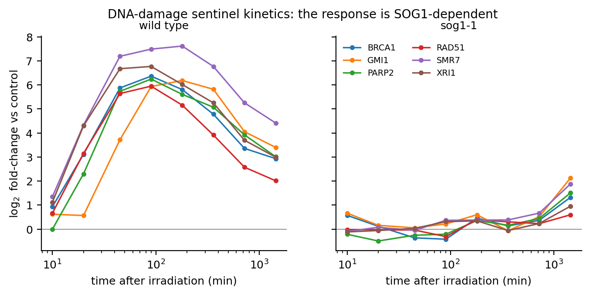
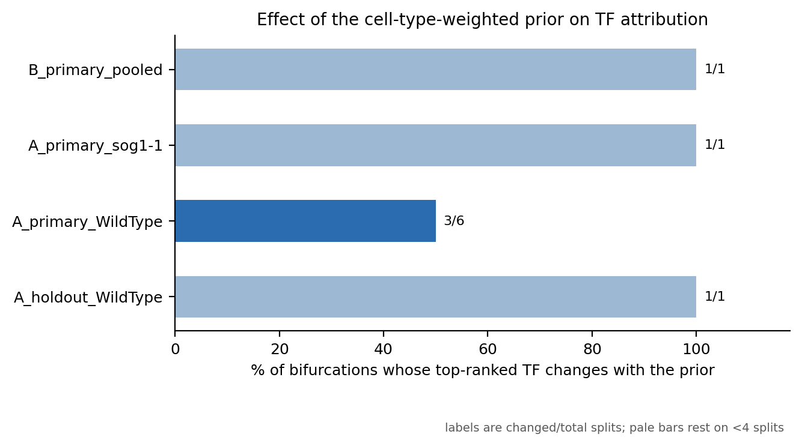
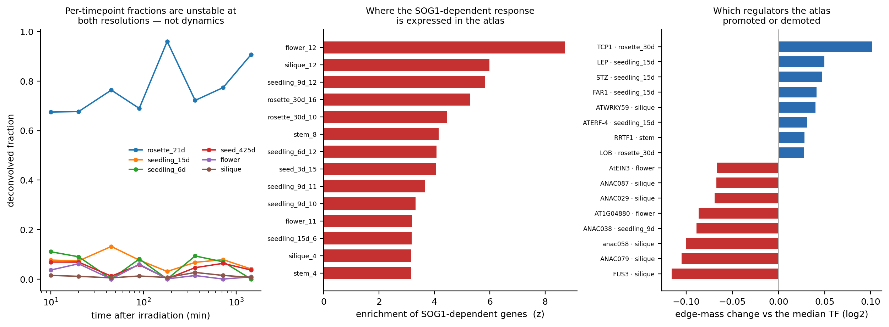
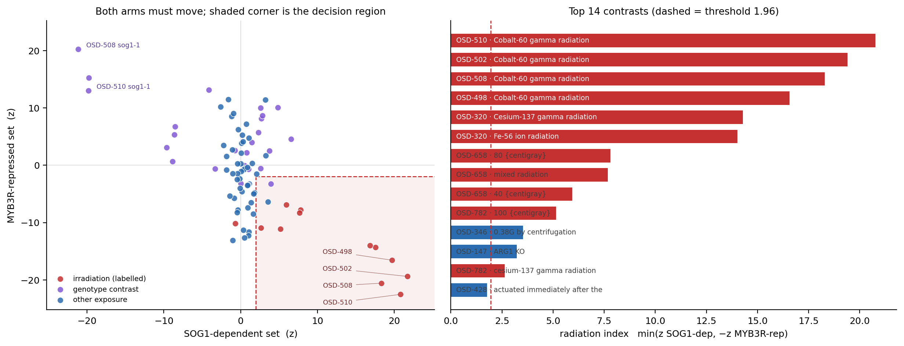
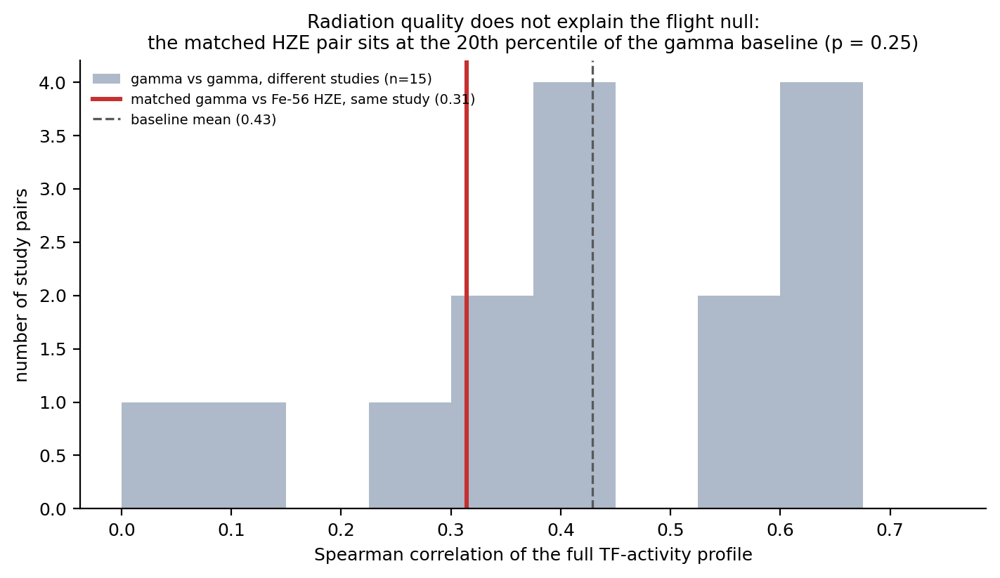
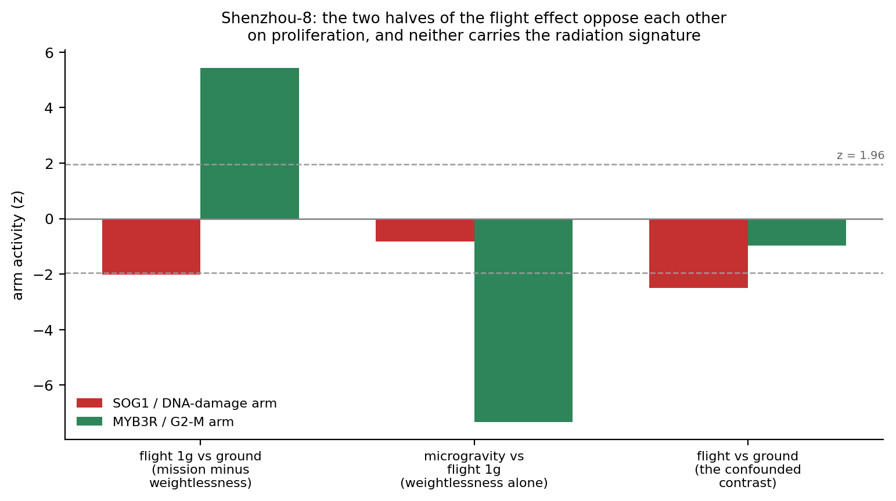
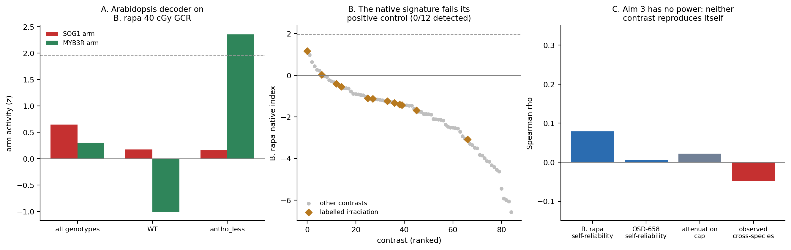
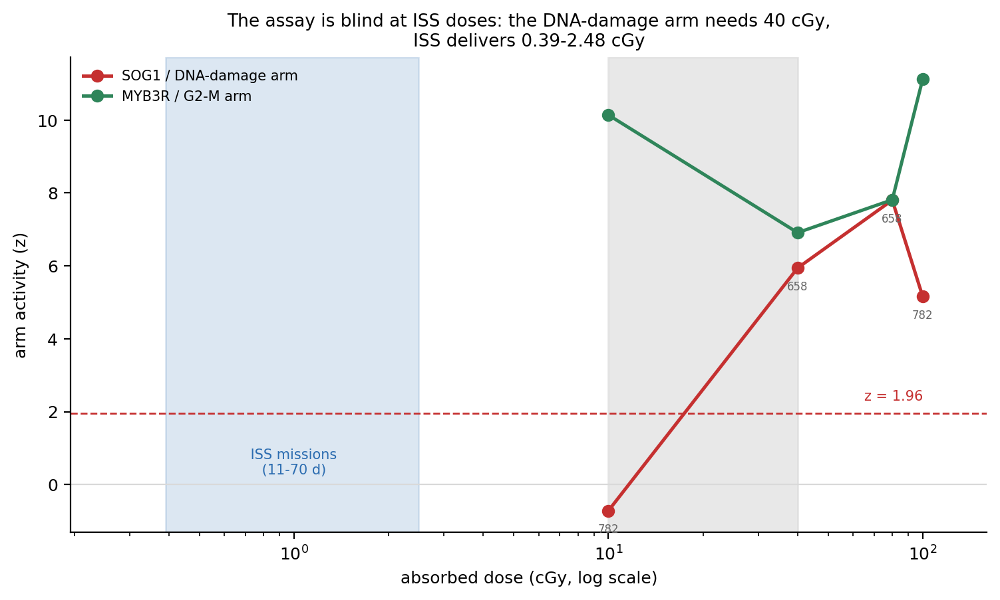
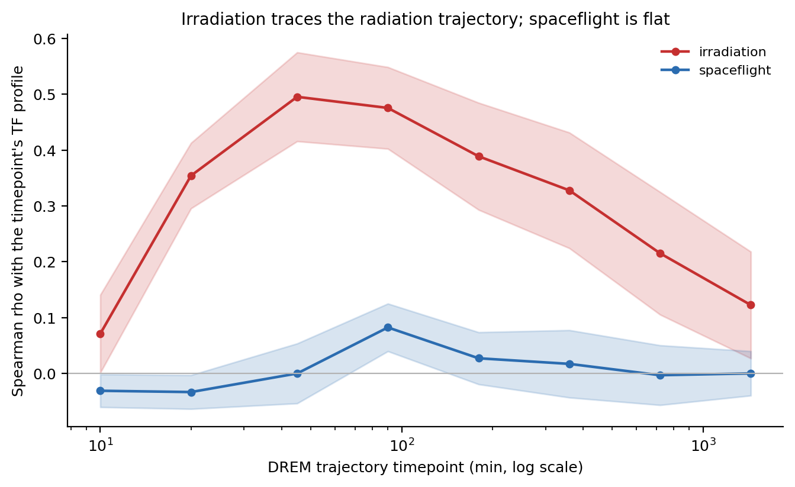

# arabidopsis-drem-osdr

Cross-study **pseudo-time-series** from NASA's Open Science Data Repository (OSDR),
modelled with the **Dynamic Regulatory Events Miner (DREM 2.0.7)**, with a single-cell
atlas acting **on the model** rather than on its annotation.

---

## What this does that DREM and iDREM do not

DREM finds bifurcations in a time-series and attributes each to the transcription factors
whose targets are enriched along one branch. That attribution depends on a static
TF–gene interaction prior which is normally **binary and tissue-blind**: an edge says a TF
*can* bind a promoter, not that the TF is present in the cells producing the signal.

iDREM accepts single-cell data, but its documentation is explicit that the cell-type data
"is not used when predicting the iDREM model" — it annotates finished nodes.

This pipeline moves that information upstream without modifying the engine. **DREM reads
the third column of its TF–gene file as a score in `[0,1]`, not as a binary flag**, and
that column is a sufficient channel: each timepoint is deconvolved against a 183-cluster
single-nucleus atlas, and every edge is re-weighted by whether its TF is expressed in the
cell types actually present.

The experiment is the ablation. Each arm is fitted three times under an identical search,
pinned seed and identical data, differing only in the prior:

| prior | column 3 | question it answers |
|---|---|---|
| `flat` | all edges `1.0` | what DREM normally gets |
| `binding` | DAP-seq / ChIP score | does binding confidence alone matter? |
| `weighted` | binding × cell-type context | does cell-type context change the attribution? |

If the weighted prior changes nothing, that is the finding and it is reported as such.

---

## The data

Screening all **62** *Arabidopsis thaliana* studies in OSDR for a parsable numeric time
axis and Illumina RNA-seq yields two cohorts. Every number below is measured by
`scripts/02_harmonise_metadata.py` and re-checked on each run, never asserted.

### Cohort A — γ-irradiation (primary)

**108 timed samples over 10 timepoints, 10 min → 72 h**, plus 36 untreated anchor samples.

| Study | Timepoints (min) | Genotypes | Role |
|---|---|---|---|
| OSD-498 | 10, 20, 90, 1440 | WT | core (`gIR vs mock wt`) |
| OSD-508 | 10, 20, 45, 90, 180, 360, 720, 1440 | WT, **sog1-1** | core (`t vs t0`) |
| OSD-510 | 20, 90, 180, 360, 720, 1440 | WT, **sog1-1** | core (`DREMmodel`) |
| OSD-782 | 60, 180, 1440, 4320 | WT | independent lab, low dose — **held out** |
| OSD-502 | — | WT, myb3r135 | repressor anchor (no time axis) |

**An honest statement of provenance.** OSD-498, OSD-508 and OSD-510 are three accessions
of *one* experiment — [Bourbousse, Vegesna & Law, *PNAS* 2018](https://doi.org/10.1073/pnas.1810582115),
who built their own DREM model over these data and reported **11 co-expressed gene
groups**. Assembling them is useful (it is how the 10 and 45 min timepoints join the 24 h
course) but it is **re-assembly, not integration**. The genuinely cross-study arm is
OSD-782 — which is also where the design is weakest, because it crosses a dose regime
(10–100 cGy against the core's high dose) and is therefore held out rather than pooled.

### Cohort B — spaceflight development (secondary)

**115 samples over 3 timepoints (4, 6, 8 d)**, two ecotypes (Col-0, WS) and two root-skewing
mutants (*sku5* in WS, *sku6* in Col-0), from OSD-193/218/281/437.
Reported as a generalisation test, not a co-equal result.

**OSD-219 is excluded**: all 32 of its BioSample IDs are identical to OSD-218's. The
duplicate is re-detected from sample-name overlap on every run rather than hard-coded, so
the exclusion cannot outlive the condition that justifies it.

---

## Results

**The response is SOG1-dependent, and the pipeline recovers that before any model is
fitted.** After batch harmonisation, all six canonical DNA-damage sentinels exceed 2-fold
induction in wild type — SMR7's log2 fold-change rises from 1.34 (10 min) to 7.62 (3 h) and
decays to 4.42 (24 h) — while in `sog1-1` none reaches 2-fold before 24 h, only 4 do at 24 h,
and RAD51's peak log2 fold-change falls from 5.95 to 0.60. (All values are log2 fold-change
against untreated controls, from `results/pseudotimeseries/series_qc.json`.) No step
in the harmonisation sees genotype, so this is the strongest available evidence that the
cross-study assembly measures biology rather than batch structure.



**DAP-seq does not contain SOG1.** The standard *Arabidopsis* binding atlas never assayed
the master regulator of the DNA-damage response. A DREM model built on it would produce a
complete, plausible, entirely SOG1-free attribution, and **nothing in the output would
signal the omission**. `scripts/04b_sog1_chip_prior.py` closes the gap by calling SOG1
peaks from the source study's own ChIP-seq (OSD-496 / GEO GSE112529) — 1,720 target genes,
requiring enrichment over *both* the matched input and the no-FLAG wild-type IP.
`04_fetch_tf_prior.py` now reports the presence of every key regulator on each run.

**The TF attribution reproduces the published regulatory logic.** Across all 12 models
(4 arms × 3 priors), SOG1 ranks **first of 479 scored TFs** in the wild-type model under
every prior, and falls in the knockout — far under the flat and weighted priors, to 6th
under the binding prior:

| Prior | SOG1 rank, wild type | SOG1 rank, *sog1-1* |
|---|---|---|
| flat | **1** | 233 |
| binding | **1** | 6 |
| weighted | **1** | 294 |

Ranks are among the 479 TFs DREM scores, with each split collapsed to one score per TF (its
best branch) by `scripts/10b_genotype_rank_per_tf.py` →
`results/comparison/genotype_rank_per_tf.tsv`. A one-vs-others split lists every TF once per
branch (1,437 rows), so the row ranks in `results/comparison/genotype_contrast.tsv` (404 and
574 for the mutant) are not ranks among TFs.

MYB3R1 ranks 1–5 in wild type and 1–6 in the mutant, as expected for a repressor
whose activity does not depend on SOG1. This is the activator/repressor logic Bourbousse
et al. reported, recovered from an independently reconstructed pipeline — and only
possible because SOG1 edges were added from ChIP-seq.

**The prior changes marginal calls, not canonical ones.** Of 6 wild-type bifurcations,
3 change their top-ranked TF between priors. The three that *hold* are attributed to SOG1
(×2) and MYB3R1. The three that *move* are reassigned among WRKY33, TCP15, ANAC071, bZIP3
and MYB49 — the weaker calls. Only the wild-type arm resolved enough splits to read this
from; the other arms each resolved one.

**Independent corroboration.** The sibling repo `Plant_response_to_radiation` analyses
overlapping studies with a Gaussian-process autoencoder and WGCNA — no DREM, no TF
attribution. Over the 314 genes both modelled, **7 of 10 DREM nodes enrich a WGCNA module**
at Bonferroni-corrected *p* < 0.05.



### The cell-type weighting is specific, not diffuse

The atlas informs 57 of 479 TFs. The six most-demoted regulators are **FUS3, ANAC079,
ANAC058, ANAC038, AT1G04880 and ANAC029**. Four of the six (FUS3, ANAC079, ANAC058, ANAC029)
peak in **silique** clusters; ANAC038 peaks in a 9-day seedling cluster and AT1G04880 in a
flower cluster. Bourbousse irradiated *seedlings*: for the four silique-restricted factors,
DAP-seq says they can bind, but they aren't in the tissue. At the script's own threshold
(a 0.1 change relative to the median TF) three regulators are demoted (FUS3, ANAC079,
ANAC058) and one is promoted (TCP1, peaking in a 30-day rosette cluster); the next five
(LEP, STZ, FAR1, WRKY59, ERF4) shrink only slightly less than the median, four of them
peaking in 15-day seedling clusters and WRKY59 in a silique cluster
(`results/qc/tissue_association_qc.json`).

SOG1 is itself a NAC (ANAC008), so the lever discriminates *within* the family rather than
against it. That is why the ablation left SOG1 and MYB3R1 untouched while reassigning the
marginal calls.

**Tissue association** was tested against the atlas expression matrix directly, because
the per-timepoint deconvolution is not stable (median relative swing 0.60 at cluster
level; aggregating to organ does **not** help, 0.61 — measured, not assumed). The
time-averaged composition the weighting consumes *is* stable (bootstrap CV 0.22).

| Gene set | Top clusters | Significant clusters |
|---|---|---|
| MYB3R-repressed (G2/M) | silique z=26.2, seedling_6d z=23.3, rosette_21d z=23.2 | 35 / 183 |
| SOG1-dependent | flower z=8.7, silique z=6.0, seedling_9d z=5.8 | 20 / 183 |

The asymmetry is the point: only dividing cells have a G2/M programme to shut down, so the
**repressive** arm is tissue-restricted, while any cell can mount a damage response, so the
**activating** arm is broad.



### A radiation decoder, applied across OSDR

The WT/*sog1-1* contrast defines what one genotype cannot: 160 genes induced in WT, bound
by SOG1, and losing induction in the mutant. Scoring these across all 62 OSDR *Arabidopsis*
studies gave 85 contrasts from the 39 studies with a usable expression matrix and control
(`results/decoder/scan_qc.json`).

Scoring the activated arm alone is **not enough** — DNA-damage mutants raise it without any
exposure. The index is a conjunction requiring both arms:

```
radiation_index = min( z(SOG1-dependent),  −z(MYB3R-repressed) )
```

The difference of the two arms was tried first and **rejected**: it promoted six
spaceflight/altered-gravity contrasts on the repressed arm alone, with SOG1-dependent
z ≈ 0. Spaceflight represses G2/M because growth slows, not because DNA is damaged.

At a fixed threshold of 1.96 (each arm individually significant, not fitted):

| | result |
|---|---|
| labelled irradiation detected | **11 / 12** |
| false positives among 49 other exposures | **1** (OSD-346, 0.38 g centrifuge) |
| non-radiation genotype contrasts called radiation-like | 1 (OSD-147, *ARG1* KO) |
| AUC | 0.96 |

(`results/decoder/decoder_report.json`.) Scores order by dose — Co-60 γ (100 Gy) 16.6–20.8,
OSD-320 Cs-137 γ 14.3 and Fe-56 14.0, simulated GCR 7.8 at 80 cGy and 5.9 at 40 cGy (7.7 for
OSD-658's pooled "mixed radiation" level), OSD-782 100 cGy 5.2 and its pooled Cs-137 level
2.6, and 10 cGy not detected (−0.72) — and the `sog1-1` / `myb3r135` genotype contrasts sit
at the opposite extreme (−19.8, −21.2, −13.1), the decoder recognising the knockouts as the
inverse.

**Two non-radiation contrasts cross the threshold.** OSD-346's 0.38 g in-flight centrifuge
level (index 3.53, scored against the onboard 1 g centrifuge) and the OSD-147 *ARG1*
knockout (3.23). The OSD-346 call is isolated — its other five partial-gravity levels and
its microgravity level all fail — and provisional, because its control pool is wrong (see
[Known issues](#known-issues)). Every other spaceflight, altered-gravity, mutant and
treatment contrast fails the threshold. Separately, 23 of the 85 contrasts (16 of the 41
flight and altered-gravity contrasts) show G2/M repressed with the SOG1 arm flat —
proliferation slowing without DNA damage — but across the flight population the mean
MYB3R-arm z is only 1.00 against a SOG1-arm mean of 0.17, so this is not a
population-level effect.



### Is terrestrial gamma the wrong *kind* of radiation? We tested it — no.

The obvious explanation for the flight null is that ground gamma studies don't model space
radiation. **OSD-320 tests this cleanly**: the same study irradiated 8-day-old Ws/*atm-1*
seedlings at Brookhaven with *both* Cs-137 gamma (100 Gy) and 1 GeV/n Fe-56 HZE ions
(30 Gy) — same tissue, same facility, same 7 Gy/min dose rate, same harvest times.

Across responsive TFs the two arms correlate at **ρ = 0.31**. The honest reference is how
well two *gamma* irradiation contrasts from different accessions agree: **mean 0.42 over
15 pairs, range 0.045–0.64** (`results/qc/radiation_quality_qc.json`; 6 of the 15 pairs are
within the single Bourbousse experiment, 9 cross laboratories). The
matched HZE pair sits at the **20th percentile** of that — inside the distribution, not
below it (one-sided p = 0.25).

We pre-registered that the quality claim required the matched pair in the *lower tail*.
It isn't. Comparing against the baseline *mean* would have passed — which is exactly why
that test was rejected in advance.

**But the baseline is the real finding.** OSD-498 and OSD-508 are two accessions of the
*same published experiment* and their TF profiles correlate at **0.045** — the
reproducibility floor of this measurement. Response magnitude doesn't explain the scatter
either (ρ=0.16, p=0.42). With 8 radiation contrasts, study-to-study variance is as large as
any quality effect this design could resolve.

So the honest answer is two-sided: **no evidence** that quality explains the flight null,
and **no power to exclude** it. What is clear is that all three qualities — photon, HZE
particle, simulated GCR — fire both arms of the decoder. The conserved DNA-damage core
doesn't care what delivers the energy.



### An in-flight 1 g control: is the flight null an artefact of the confound?

Most OSDR flight contrasts confound weightlessness with the rest of the mission, so an
absent radiation signature could in principle be a microgravity response masking one.
OSD-251 and OSD-346 already supply in-flight 1 g centrifuge contrasts — weightlessness and
partial gravity with the mission held constant — but OSDR records no ground arm for them,
so they cannot isolate the rest of the mission. The Shenzhou-8 SIMBOX experiment ([E-MTAB-2518](https://www.ebi.ac.uk/biostudies/arrayexpress/studies/E-MTAB-2518),
Fengler et al. 2015) flew a **1 g reference centrifuge alongside the microgravity samples**
and kept a ground control, which lets the mission be split in two.

| Contrast | SOG1 arm | MYB3R / G2-M arm | radiation index |
|---|---|---|---|
| flight 1 g vs ground — mission *minus* weightlessness | −2.02 | **+5.44** | −2.02 |
| microgravity vs flight 1 g — weightlessness alone | −0.83 | **−7.33** | −7.33 |
| flight vs ground — the confounded contrast | −2.49 | −0.97 | −2.49 |

The radiation index stays below threshold in **both** halves, so the flight null is not an
artefact of the confound. That is only a consistency check: at ~0.18 cGy over 5 days the
mission sits far below the assay's floor and a null is predicted by dose alone.

What the split *does* show is that the confound is real for other quantities. The
MYB3R/G2-M arm moves in **opposite directions** in the two terms and nearly cancels when
they are summed — so an absent signal in a flight-versus-ground contrast can be a
cancellation rather than a quiet pathway. Caveats are structural and stated with every
number: the two arrays per condition are front/rear positions in one hardware container
(positional, not biological, replicates), the material is semisolid callus culture, and it
is a single mission.



### A second species: *B. rapa* under simulated GCR

If terrestrial Arabidopsis gamma is the wrong training material, a second species irradiated
with **simulated GCR at 40 cGy** — dose- and quality-matched to OSD-658's lower arm — is the
obvious test. First it needed orthology, and the usual route is broken: Ensembl Plants has no
Arabidopsis-homolog attribute for *B. rapa*, which is why `annotation/brapa_to_arabidopsis_orthologs.tsv`
in the LLGCSS repo was an empty file holding that error when this analysis was run (it has
since been repopulated there). DIAMOND reciprocal best hit fixes it:

| | existing BioMart map | RBH (`scripts/26`) |
|---|---|---|
| B. rapa genes mapped | 3,511 | **18,770** |
| DREM TFs reachable | 21% | **426/474** |
| SOG1 / MYB3R1 | ✗ ✗ | **✓ ✓** |
| agreement with Ensembl's own call | — | 96.6% |

**The result is honest but not decisive, and the controls say why.**

- **Aim 1** — the Arabidopsis decoder does **not** fire on *B. rapa* at 40 cGy (WT index −1.01
  vs threshold 1.96). Readable, because the decoder is a validated instrument.
- **Aim 2** — a *B. rapa*-native signature screened over 85 contrasts in 39 OSDR studies finds
  nothing in spaceflight, **but fails its positive control**: it detects 0/12 labelled
  irradiations and scores *worst of all* on a 100 Gy gamma exposure (−3.08). A signature that
  cannot see 100 Gy tells us nothing by failing to see spaceflight. Reported as a failed
  instrument, not a result.
- **Aim 3** — gene-level cross-species concordance has **no power**. Split against itself, the
  OSD-658 40 cGy contrast reproduces at 0.006 and *B. rapa* at 0.079, so attenuation caps any
  correlation between them at **0.02**. The observed −0.05 is exactly what that predicts. This
  says nothing about conservation; it says these two datasets cannot be compared gene by gene.

Rank scoring over hundreds of genes survives noise that per-gene correlation does not — which
is why aim 1 is readable and aim 3 is not. The binding constraint is **replication per dose
arm**, not species choice.



### So why does spaceflight show nothing? Dose, and the magnetosphere

The DREM model was trained on **100 Gy** Co-60 delivered in ten minutes (parsed from the
OSD-508 protocol, not assumed). An ISS plant experiment receives **0.39–2.48 cGy** over
1–10 weeks — **~4,000× less dose at a ~4×10⁷ lower dose rate** (100 Gy in 10 min is
16.7 cGy/s; 0.355 mGy/day is 4.1×10⁻⁷ cGy/s; 16.7 / 4.1×10⁻⁷ ≈ 4.1×10⁷).

And that low dose is not incidental: the ISS orbits deep inside the magnetosphere, where
the geomagnetic cutoff deflects lower-rigidity particles and residual exposure is dominated
by trapped protons in the South Atlantic Anomaly plus a strongly modulated GCR component
([Reitz 2008](https://doi.org/10.1016/j.zemedi.2008.06.015)); beyond it that shielding is
absent ([Slaba 2025](https://doi.org/10.1038/s41526-025-00459-y)).

**The inversion worth stating:** for radiation specifically, LEO is a *shielded* environment
and a poor analogue of deep space. A ground GCR simulator like NSRL may model the
deep-space particle spectrum better than the ISS does. A negative radiation result from ISS
plants is evidence about low Earth orbit — not about a Mars transit.

### Can we conclude ISS plants carry no radiation biomarkers?

**Yes — and here is the dose at which we could have seen one.** OSD-658 and OSD-782 are
both integrated, as *ground* calibration (`is_flight=False`), and they define the assay's
sensitivity. Recovering OSD-658's 40/80 cGy arms (its unirradiated samples are recorded as
`{Not Applicable}`, not `0 cGy`, so its dose factor had no internal reference) gives a
four-point dose series:

| Dose | SOG1 / DNA-damage arm | MYB3R / G2-M arm |
|---|---|---|
| 10 cGy | **−0.72** (absent) | +10.14 |
| 40 cGy | +5.94 | +6.91 |
| 80 cGy | +7.80 | +7.81 |
| 100 cGy | +5.16 | +11.13 |

**The two arms have different thresholds.** Cell-cycle arrest is low-threshold and
saturates; the SOG1 damage programme is switch-like, absent at 10 cGy and detectable at
40 cGy. "The detection floor" is not one number — and only the diagnostic arm separates
irradiation from other stress.

At **0.355 mGy/day** measured inside the ISS by Bio-PADLES over 1,584 days
([Yoshida et al. 2022](https://doi.org/10.1016/j.heliyon.2022.e10266)), the 10 orbital
missions here (11–70 days) accumulate **0.39–2.48 cGy** — **4× below the dose that already
registers nothing**, at a dose rate ~3×10⁶ times lower than that 10 cGy exposure's
1.4 cGy/s (`results/qc/dose_response_qc.json`).

So: ISS plant transcriptomes carry no detectable radiation-damage biomarker as we define
one. That **bounds** the ISS radiation effect below our floor; it does not show that no
damage occurs. Transcription is a poor dosimeter at ISS dose rates.



### Are the DREM transcription factors altered in spaceflight? No.

Two acquisition fixes widened the corpus first — admitting the **onboard 1G-centrifuge
control** (recovers OSD-251/346, all-flight gravity gradients whose only control is that
centrifuge) and reading GeneLab's **Affymetrix tables**, which carry AGI loci in a `TAIR`
column. Result: 85 contrasts from 39 studies (62 RNA-seq + 23 microarray), 41 flight
contrasts over 14 mission groups — one of them an "unknown" bucket holding the two F-104
parabolic-flight studies, OSD-428 and OSD-434, which OSDR records without a mission name
(`results/tf_activity/contrast_meta.tsv`). Each of 474 DREM TFs becomes a feature — its target set scored against the
contrast's fold-change ranking, with an **exact analytic null** (finite-population
correction) verified against permutation.

| Test | Result |
|---|---|
| TFs significantly altered in flight (5% FDR, mission-level) | **0 / 474** |
| TFs differing significantly between flight and radiation | **54 / 474** |
| SOG1 activity: radiation vs flight | **+8.34** vs **−0.27** (q=0.90) |
| Flight-vs-radiation classifier, leave-one-mission-out | **AUC 0.993** (null 0.448 ± 0.166, p=0.005) |
| Platform confound control | AUC 0.446 — at chance, **not** confounded |

The zero is a measurement, not weak power: the same features and correction detect 54 TFs
separating flight from radiation, and a classifier separates them near-perfectly.

**Spaceflight is not a time-shifted radiation response.** Projecting every contrast onto
the eight DREM timepoints, irradiation traces a clean peak (ρ 0.50 at 45 min, 88% of
argmaxes at the peak) while flight is flat (peak ρ 0.082, range 0.116, 46% near peak).



**A bonus validation.** OSD-320 — Affymetrix, never used to build the signature, previously
excluded as cross-platform — scores 14.3 (Cs-137 γ) and 14.0 (Fe-56) on the radiation
index. The signature transfers to an unseen platform.

---

## Layout

| Path | Contents |
|---|---|
| [`scripts/`](scripts/) | Numbered pipeline, `00`–`27`; `run_all.sh` runs the lot |
| [`data/`](data/) | Harmonised metadata and the TF prior (large inputs re-fetched, see `MANIFEST.tsv`) |
| [`results/`](results/) | Pseudo-time-series, cell-type fractions, DREM models, comparisons, and a QC report per stage |
| [`figures/`](figures/) | Rendered figures (PDF + PNG) |
| [`manuscript/`](manuscript/) | LaTeX source; `make pdf docx` builds both from it |

### Pipeline

```bash
bash scripts/run_all.sh --dry-run   # resolve every URL, download and fit nothing
bash scripts/run_all.sh             # full run
```

| Step | Does |
|---|---|
| `00_env_check.py` | Verifies Java, pandoc and LaTeX; prints the exact `brew` command for anything missing |
| `01_fetch_osdr.py` | Acquires counts + runsheets; file counts are **measured**, never asserted |
| `02_harmonise_metadata.py` | Builds the time axis; **five QC gates** that fail the run |
| `03_build_pseudotimeseries.py` | Within-study referencing, shared-timepoint offset removal, sentinel check |
| `04_fetch_tf_prior.py` | DAP-seq prior + symbol resolution; reports key-regulator coverage |
| `04b_sog1_chip_prior.py` | SOG1 edges from ChIP-seq with dual controls |
| `05_deconvolve_celltypes.py` | NNLS cell-type fractions + latent trajectories |
| `06_weight_tf_prior.py` | **The auto-decoder lever**; writes all three priors |
| `07`–`09` | DREM inputs → batch run → tidy tables |
| `10_compare_models.py` | Ablation, genotype contrast, published-model calibration |
| `10b_genotype_rank_per_tf.py` | SOG1/MYB3R1 ranks among TFs (one score per TF per split) |
| `11_crossvalidate_sibling.py` | DREM paths vs the sibling repo's WGCNA modules |
| `15`–`16` | Radiation signature from the WT/`sog1-1` contrast; scan every OSDR plant study |
| `17`–`18` | Decoder calibration + predictions; tissue attribution and reweighting |
| `19`–`20` | TF-activity matrix (analytic null); per-TF mission-level tests with FDR |
| `21`–`22` | Mission-grouped classifier + platform control; DREM trajectory projection |
| `23` | Dose-response, detection floor, and ISS mission dose |
| `24` | Radiation quality: matched HZE-vs-gamma test against a gamma baseline |
| `25` | Shenzhou-8 (E-MTAB-2518): decompose flight using its in-flight 1 g centrifuge |
| `26` | *B. rapa* → Arabidopsis orthologs by DIAMOND reciprocal best hit |
| `27` | Three cross-species aims against the *B. rapa* simulated-GCR experiment |
| `12`–`14` | Figures, manuscript macros, `MANIFEST.tsv` |

---

## Reproducibility

- **Every manuscript number is generated.** `13_manuscript_numbers.py` writes
  `generated_numbers.tex` from `results/`; the prose only ever writes a macro. A value the
  pipeline has not produced renders a visible `TODO` in the PDF rather than a plausible
  stale figure.
- **Every citation is resolved against Crossref**, and `check_references.py` asserts the
  expected first author and year. This is not decoration: four DOIs written from memory
  during development resolved cleanly to *entirely different papers* (iDREM to a
  Gaussian-process paper, an *Arabidopsis* atlas to a *Drosophila* chromatin study). A
  resolve-only check passed all four. The author/year assertion is what catches them.
- **DREM is the real engine**, downloaded and checksummed rather than vendored, and the
  wrapper is validated against DREM's own bundled example before any study data is fitted.
- **QC reports are per stage** in `results/qc/`, and the gates fail the run rather than
  warn.

## Known issues

Found by an evidence audit on 2026-10-28. Each needs a re-run, so none is fixed yet.

- **The wild-type DREM run records do not show which run produced the committed models.**
  `results/drem/runs/A_primary_WildType__weighted/drem.log` records a
  `java.lang.OutOfMemoryError`. `results/drem/run_report.json` gives that run exit code 1 but
  `"ok": true`, and lists the wild-type flat and binding runs as failed even though their
  models and successful logs are committed. `scripts/08_run_drem.py` does not delete an
  earlier `model.txt` before a run, and counts any existing one as success. The three
  `A_primary_WildType` arms need a clean re-run: outputs cleared first, and success meaning
  exit code 0 plus a freshly written model.
- **MYB3R4, MYB3R5 and ERF115 are missing from the prior.** GEO GSE60143 has DAP-seq peaks
  for all three (GSM1925443 MYB3R4, GSM1925444 MYB3R5, GSM1925091/2 ERF115), but the
  symbol resolver in `04_fetch_tf_prior.py` did not map them, so none has edges.
  `results/qc/tf_prior_qc.json` says MYB3R4 and ERF115 were "not assayed in DAP-seq"; that
  is wrong — they were assayed and left unresolved. Fixing it changes the prior, so every
  DREM model needs re-fitting.
- **OSD-346's control pool is wrong.** The control pattern `\b1\s*G by centrifugation\b`
  in `16_scan_osdr_plants.py` also matches "0.1G by centrifugation". OSD-346's controls
  therefore mix 8 onboard 1 g samples with 6 at 0.1 g (`n_control` = 14), and mix *phyA*
  with *phyB* mutants while its 0.38 g samples are all *phyA*. The OSD-346 0.38 g
  radiation-like call, and every other OSD-346 contrast, stays provisional until the scan is
  re-run with the pattern anchored.
- `NumArabidopsisStudiesScreened` (62) is a literal in `13_manuscript_numbers.py`, not read
  from an output; it matches `n_studies_in_api` in `results/decoder/scan_qc.json`.
- The within-mission permutation null quoted in the manuscript (0.993 ± 0.000) appears only
  in the docstring of `21_tf_classifier.py`, not in any current output, and is marked TODO.
- The *B. rapa* simulated-GCR dataset has no accession or citation yet (TODO in the
  manuscript).

## Limitations

- The single-nucleus atlas is developmental and unirradiated; deconvolution assumes
  cell-type signatures are stable under γ-irradiation. That is an assumption, not a finding.
- Two biological replicates per genotype × timepoint cell in OSD-508/510.
- Cohort B pools two ecotypes (Col-0, WS) and two root-skewing mutants (*sku5* in WS,
  *sku6* in Col-0); genotype is uncontrolled within it.
- SOG1 peaks are called from bedGraph coverage by binned enrichment, because GEO
  distributes coverage rather than called peaks for GSE112529. The dual-control
  requirement makes the calls conservative but they are not a MACS analysis of raw reads.
- The spaceflight analysis is *Arabidopsis*-only **and not by choice**: Ensembl returns
  zero Arabidopsis→mouse orthologues for SOG1, MYB3R1 or E2F3 (plant and vertebrate
  Compara are separate databases; SOG1 is a plant-specific NAC). The 132 mouse and 29
  human spaceflight studies in OSDR cannot be scored on these regulators.
- Effective n for the flight analysis is **14 mission groups**, several contributing one
  study, and one of them the "unknown" bucket holding OSD-428 and OSD-434.
- The detection floor is measured for **acute** exposure (1.4 cGy/s). ISS delivers
  chronically at a ~3×10⁶ lower dose rate, where repair keeps pace, so the chronic floor is plausibly higher
  still — widening the gap, not narrowing it. ISS dose is crew-module dosimetry, not a
  dosimeter inside the plant hardware.
- An earlier version of this README reported a much larger flight MYB3R-arm mean from a
  smaller corpus; the expanded corpus puts it at **1.00** (below significance). The
  G2/M-in-flight pattern holds for 16 of 41 contrasts, not as a population effect.
- The decoder is *Arabidopsis*-only. Only two OSDR plant studies with expression matrices
  were non-*Arabidopsis* when this was surveyed (one *B. rapa*, one tomato). **TODO:
  re-count** — the earlier "73 plant studies, 33 with matrices" predates the 39
  *Arabidopsis* studies now scored. The sibling repo's `ortholog_map.csv` turns out to be
  32,833 Arabidopsis-to-itself identity rows, so it
  provides no cross-species mapping. Scoring those two would need real orthology.
- "No radiation signature in spaceflight" is bounded by what these datasets sample —
  mostly 4–12 day seedlings, days to weeks of LEO exposure. It is not a statement about
  deep-space or chronic high-LET exposure.
- The atlas signature matrix covers 4,000 highly variable genes, so the lever re-weights
  the subset of edges where cell-type context exists. Genes outside that set are
  cell-type-invariant by construction and pass through unchanged;
  `scripts/build_full_signatures.R` widens this for users with R and the atlas object.

## Licence

Code MIT; data, figures and prose CC-BY-4.0. DREM is GPL-3.0 and is downloaded at run
time, not redistributed. NASA OSDR and GEO data retain their own terms — cite the original
investigators, listed in [`MANIFEST.tsv`](MANIFEST.tsv). See
[`LICENSE_NOTES.md`](LICENSE_NOTES.md).
